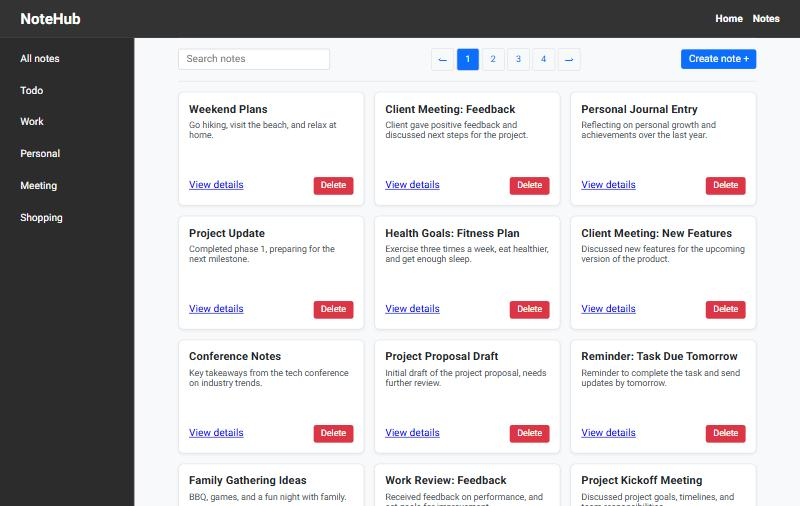
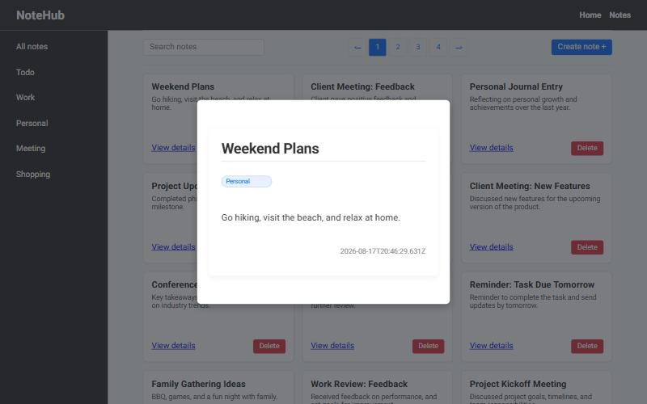
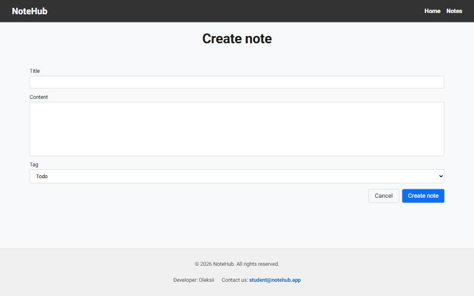

# NoteHub

> A notes app built with the Next.js App Router: filter by tag, search, preview notes in a modal without leaving the list, and create notes with an auto-saved draft.


**🔗 Live demo:** [notehub-lite.vercel.app](https://notehub-lite.vercel.app/notes/filter/all) · 🇺🇦 [Українська версія](./README.uk.md)



## About

NoteHub is a small CRUD app for personal notes, built on a public study API during the GoIT Next.js course. The goal of the project was to practise the routing features that make the App Router different from a plain SPA: catch-all, parallel, and intercepting routes, plus server-side prefetching with TanStack Query.

## Features

- **Tag filtering through the URL.** A catch-all route `/notes/filter/[...slug]` handles `/notes/filter/all` and `/notes/filter/Work`. Every filtered view has its own link that you can share or refresh.
- **Tag sidebar as a parallel route.** The menu lives in the `@sidebar` slot of the filter layout, independent of the list. Its `default.tsx` makes it render on every tag URL, including after a hard refresh.
- **Note preview in a modal (intercepting route).** Clicking "View details" opens the note in a modal over the list (`@modal/(.)notes/[id]`), and the URL changes to `/notes/:id`. A direct link or a page refresh opens the full note page instead. Esc, a backdrop click, or the browser Back button closes the modal.
- **Server prefetch and hydration.** The list and note pages prefetch data on the server (`prefetchQuery` → `dehydrate` → `HydrationBoundary`), so the first paint already contains notes. After that, TanStack Query on the client handles search and pagination.
- **Search and pagination.** Search is debounced by 500 ms (`use-debounce`) and pagination uses `react-paginate`. `keepPreviousData` keeps the current page on screen while the next one loads, so the list does not flicker.
- **Create a note with a persistent draft.** The form has its own route (`/notes/action/create`) and uses a React 19 form action with Yup validation. The draft is stored in Zustand with the `persist` middleware (localStorage), so it survives a refresh or navigating away, and it is cleared after a successful submit.
- **Delete with cache invalidation.** Deleting runs a `useMutation`, invalidates the `["getNotes"]` queries, and shows a toast notification.
- **SEO metadata on every route.** Static metadata covers the home and create pages; `generateMetadata` covers each tag and each note, including Open Graph. `fetchNoteById` is wrapped in `React.cache()`, so metadata generation and page rendering share a single request.
- **Error and loading boundaries.** Each segment has its own `error.tsx`, plus a global `not-found.tsx` and `loading.tsx`.

| Note preview (intercepted route) | Create note |
|---|---|
|  |  |

## Tech stack

| Layer | Technology |
|---|---|
| Framework | Next.js 16 (App Router) + React Compiler |
| Language | TypeScript (strict) |
| UI | React 19, CSS Modules, modern-normalize |
| Server state | TanStack Query v5 (SSR prefetch + hydration) |
| Client state | Zustand v5 (`persist` middleware) |
| Forms | React 19 form actions + Yup |
| HTTP | Axios |
| UI helpers | react-paginate, use-debounce, react-hot-toast |
| Deploy | Vercel |

## Routing map

```
app/
├─ layout.tsx                    root layout: renders {children} and the {modal} slot
├─ page.tsx                      /
├─ @modal/
│  ├─ default.tsx                renders nothing when no modal is open
│  └─ (.)notes/[id]/page.tsx     intercepts /notes/:id on client navigation → modal
└─ notes/
   ├─ [id]/page.tsx              /notes/:id — full page (direct link or refresh)
   ├─ action/create/page.tsx     /notes/action/create
   └─ filter/
      ├─ layout.tsx              renders the {sidebar} slot next to {children}
      ├─ @sidebar/page.tsx       tag menu (default.tsx re-exports it)
      └─ [...slug]/page.tsx      /notes/filter/all | /notes/filter/:tag
```

## Design decisions

- **Why the preview is an intercepting route rather than modal state.** The modal gets a real URL, so you can share it, Back closes it, and a refresh opens the full page. With `useState`, none of that is possible.
- **Why creating a note is a separate page and not a modal.** The page has its own URL and metadata, and the draft lives outside the component, so leaving the page does not destroy it. A React 19 form action plus Yup covers validation without a form library.
- **Why Zustand for the draft.** The draft has to outlive the component (navigation) and the tab (refresh). A tiny global store with `persist` handles both without a context provider.
- **Why the data layer lives in one file.** All requests are in `lib/api.ts` with shared types in `types/note.ts`, so the API contract changes in one place.

## Getting started

```bash
npm install
```

Create a `.env.local` file in the project root with your personal token for the GoIT NoteHub API:

```
NEXT_PUBLIC_NOTEHUB_TOKEN=your_token_here
```

```bash
npm run dev      # http://localhost:3000
npm run build    # production build (also runs the type check)
npm run lint     # ESLint
```

## Project structure

```
app/          routes, layouts, parallel and intercepting slots
components/   UI components (NoteList, NoteForm, Modal, SearchBox, Pagination, …)
lib/api.ts    every API request in one place
lib/store/    Zustand store for the note draft
types/        shared TypeScript types (Note, NoteTag, NewNote)
```

## Known limitations and next steps

- [ ] **Mobile layout.** The layout is desktop-first; the sidebar and toolbar do not adapt below tablet width yet.
- [ ] **Search and page in the URL.** They are local state for now, so a search result cannot be shared and is lost on refresh.
- [ ] **API token on the server.** The token is a `NEXT_PUBLIC_` variable, so it ends up in the browser bundle. That is acceptable for a public study API; in production I would proxy requests through Route Handlers and keep the token server-side.
- [ ] **Human-readable dates.** Dates are shown as raw ISO strings; I plan to format them with `Intl.DateTimeFormat`.
- [ ] **Tests.** Unit tests for the store and the form validation (Vitest + React Testing Library).
